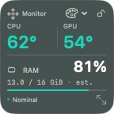
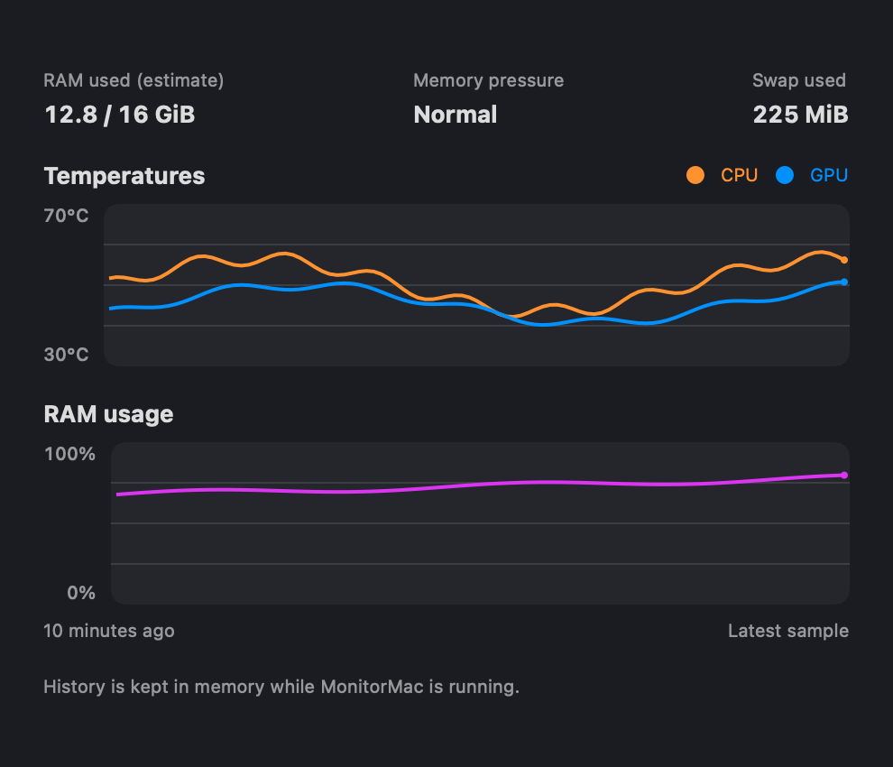

# MonitorMac

MonitorMac is a native menu bar app with a compact floating panel. The standard build shows system thermal state and estimated RAM usage, with a ten-minute memory history kept in memory while the app runs.

**Requires an Apple Silicon Mac, macOS 27 or later, and the Xcode Command Line Tools.**

## Build locally

Run `zsh build.sh` from the repository. The script prints the path to the app. Open that app in Finder and use the menu bar item to show or hide the floating panel.

A prebuilt installer is currently unavailable. The local build uses an ad hoc signature by default. A future public release needs Developer ID signing, notarization, and Gatekeeper verification before distribution.

## Experimental temperature readings

Run `zsh build.sh --experimental-sensors` to include CPU and GPU temperatures in degrees and their history. This build uses undocumented Apple sensor interfaces in read-only mode. Sensor availability varies with the Mac model and macOS version. The standard build uses the system thermal state instead.

These screenshots show example readings from the experimental build.

  
  

## Privacy and terms

MonitorMac reads metrics on the device. It sends no telemetry, and its chart history is discarded when the app exits. [See the license](LICENSE) for local use and redistribution terms.
